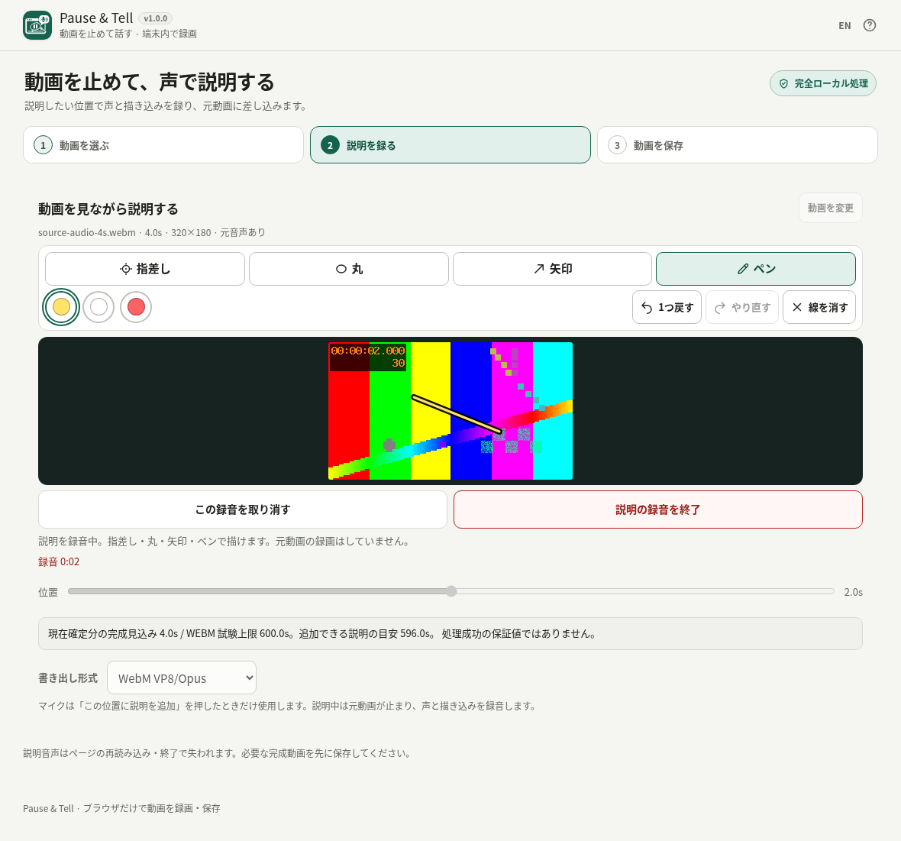

# Pause & Tell

[](https://github.com/ttomohisa/htmlapps-pause-and-tell/actions/workflows/deploy-pages.yml)
[](LICENSE)
[](https://ttomohisa.github.io/htmlapps-pause-and-tell/)

[English README](README.md)

動画を止めて声と描画で説明し、元動画全体に差し込んで保存できる、端末内処理の単一HTMLアプリです。

## 🚀 デモ

### [GitHub PagesでPause & Tellを開く](https://ttomohisa.github.io/htmlapps-pause-and-tell/)

GitHub Pagesから最初のHTMLを読み込んだ後、動画の読み込み・説明の録音・描画・動画作成は端末内で処理されます。選択した動画や録音音声は自動アップロードされません。

[](https://ttomohisa.github.io/htmlapps-pause-and-tell/)

## 主な機能

- **説明したい場面で話す** — 動画の位置を選び、静止画を見ながら声と描画を録音できます。
- **元動画の流れを保持** — 説明区間を追加し、前後の元映像と元音声を完成動画へ残します。
- **描いて伝える** — 指差し・丸・矢印・ペン、3色、戻す・やり直す・線消去を使えます。
- **説明ごとに見直す** — 確認・削除・録り直しに対応し、録り直し取消では元の説明を保持します。
- **用途に合わせて保存** — WebMを標準に、対応端末では短いMP4も選べます。保存名の編集と端末共有にも対応します。
- **ファイルを外へ出さない単一HTML** — 必要なライブラリを内包し、日本語／英語UIをPCやスマートフォンで利用できます。

## すぐに使う

### Webで使う

[デモを開く](https://ttomohisa.github.io/htmlapps-pause-and-tell/)だけで利用できます。インストールやアカウント登録は不要です。

### ダウンロードして使う

1. 公開中の[通常HTML](https://ttomohisa.github.io/htmlapps-pause-and-tell/index.html)を端末へ保存します。
2. 保存したHTMLを、WebCodecsとMediaRecorderに対応するブラウザーで開きます。

ローカルHTMLでマイクを利用できない場合はHTTPSのWeb版を使ってください。公開中のHTMLはマージ済みmainの版です。

### ビルドして使う（開発者向け）

1. このリポジトリをダウンロードまたはクローンします。
2. Node.jsを導入したWindowsで `build-standalone.bat` を実行します。
3. ビルドは `experiments/insertion-poc/package-lock.json` で固定した依存関係を取得します。
4. 生成された `dist/index.html` または同一内容の `pause-and-tell.html` を任意の場所へコピーします。
5. 以降はそのHTML単体をインターネット接続なしで開けます。マイク・コーデックの対応はブラウザーに依存します。

小さい自己展開版 `dist/index.self-extract.html` も生成します。この版は追加で `DecompressionStream` が必要です。PythonやローカルWebサーバーは通常利用には不要ですが、ビルドにはNode.jsとPowerShellが必要です。

## 使い方

1. [アプリを開き](https://ttomohisa.github.io/htmlapps-pause-and-tell/)、動画を選び、「位置」で説明したい場面へ移動します。
2. 「この位置に説明を追加」でマイクを許可し、静止画を見ながら話します。ペン・指差し・丸・矢印で描き込めます。
3. 「説明の録音を終了」。必要なら別の位置にも追加します。説明を選んで確認・削除・録り直しできます。録り直し途中の「この録音を取り消す」では元の説明が残ります。
4. 「説明を差し込んで動画を作成」→完成動画を確認→「動画を保存」。保存先から開いて再生を確認します。「共有」は対応端末だけに表示されます。

位置移動は録音前の差し込み位置選択です。説明中は元動画を静止します。描画操作は説明時刻に沿って反映され、戻す/消す操作で過去の映像まで消えることはありません。書き出し時に再エンコードするため無劣化保存ではありません。

## GitHub Pagesで公開する

このリポジトリには、単一HTMLをビルド・検証してGitHub Pagesへ公開するワークフローが含まれています。

1. リポジトリの **Settings → Pages → Build and deployment → Source** で **GitHub Actions** を選びます。
2. `main` の更新で **Deploy standalone app to GitHub Pages** が自動実行されます。
3. 成功後、[公開アプリ](https://ttomohisa.github.io/htmlapps-pause-and-tell/)へ反映されます。

公開処理は固定依存から再ビルドし、通常版・自己展開版と通信制限を検証します。PRプレビューは本番とは別です。

## 開発とビルド

```text
.
├─ experiments/insertion-poc/    # 現行エディター・package.json・npm lock
├─ assets/favicon.svg           # 共通アイコン
├─ app.config.json              # アプリ情報とビルド設定
├─ build-standalone.bat          # Windows用ビルド入口
├─ build-standalone.ps1          # 単一HTML生成
├─ scripts/                     # 検証・自己展開版生成
├─ dist/index.html              # 通常の単一HTML
└─ dist/index.self-extract.html  # 自己展開版
```

PowerShellで `./scripts/check-repository.ps1` を実行すると、ビルドと両配布版の検証を行います。生成HTMLを直接編集しないでください。

### 依存ライブラリを更新する

`experiments/insertion-poc/package.json` とnpm lockを一緒に更新し、ライセンス・該当ソース案内を確認して再ビルドします。ビルドはnpmの固定バージョンと整合性情報を検査し、ライブラリとMPL全文を内包して `dist/dependency-manifest.json` を生成します。

[AGENTS.md](AGENTS.md)・[仕様](APP_SPEC.md)・[検証方針](docs/INSERTION_TEST_POLICY.md)も参照してください。短い回帰は通常CI、長時間/native検証は節目だけ実行します。`insertion-poc` は過去のディレクトリ名で、別製品を意味しません。

## プライバシーと通信防止

動画・音声・描画はブラウザー内で処理します。自動アップロード、実行時のCDN取得、アクセス解析、サーバー処理はありません。Web版では最初にHTMLを取得します。端末の共有機能で送付先を選んだ場合だけ、完成ファイルをその相手へ送ります。

説明はセッション内のみです。再読み込み・ページ終了・OSによる終了で失われる場合があります。離れる前に必要な完成動画を保存してください。録り直しの失敗・取消では前回の説明を保持します。プロジェクトの永続保存・復元機能ではありません。

生成HTMLは `connect-src 'none'` を含むContent Security Policyを持ち、実行時ライブラリを直接埋め込みます。共有先を明示的に選ぶ端末共有を除き、アプリが素材を外部へ送ることはありません。完全にネットワークを切って使う場合は、保存済みのHTMLを開いてください。

## 制限事項

ブラウザーの録音・動画変換機能に依存します。マイク権限、MediaRecorder、WebCodecsが必要で、利用できる入出力コーデックは端末によって異なります。ローカルHTMLでマイクを使えない場合はHTTPSのWeb版を利用してください。

- 標準は **WebM VP8/Opus**。**MP4 AVC/AACは実験機能**で、**完成30秒まで**です。送付先の動画アプリがWebMに対応しない場合に便利です。
- 試行上限は元動画 **5分/250MiB**、説明1区間 **2分**、WebM完成 **10分**。処理速度・メモリー・成功を保証する値ではありません。負荷が高い端末では短い動画を使ってください。
- 書き出し時に再エンコードするため無劣化保存ではありません。HEVC/HDRや可変フレームレートなどのカメラ動画は、ブラウザーによって正しく扱えない場合があります。
- 説明はセッション内のみです。再読み込み・ページ終了・OSによる終了で失われる場合があります。プロジェクト保存・自動復元機能はないため、必要な完成動画は離れる前に保存してください。
- 全Android/iPhoneや上限いっぱいの入出力に対応を保証するものではありません。未対応コーデックは黙って置き換えず、エラーで案内します。

試した環境・測定結果は[検証記録](docs/INSERTION_POC_VALIDATION.md)を参照してください。追加のAAC/WASM代替エンコーダーは同梱していません。

## 使用ライブラリ

| ライブラリ | バージョン | ライセンス | 用途 |
| --- | ---: | --- | --- |
| Mediabunny | 1.61.5 | MPL-2.0 | メディアの読み込み、デコード、音声・映像の合成と書き出し |
| esbuild（ビルド時のみ） | 0.25.12 | MIT | JavaScriptの単一HTMLへのバンドル |

esbuildの実行ファイルは配布HTMLに含まれません。[第三者通知](THIRD_PARTY_NOTICES.md)とヘルプ内のライセンス全文・該当ソース案内を参照してください。

## コントリビューション

バグ報告や機能提案はGitHub Issuesへお願いします。開発への参加方法は [CONTRIBUTING.md](CONTRIBUTING.md)を参照してください。

## ライセンス

Copyright © 2026 ttomohisa

アプリは [MIT License](LICENSE)で公開されています。同梱ライブラリには上記の別ライセンスが適用されます。

## カタログ情報

`app.config.json` が版・配布先・通信制限を記述します。メタデータは実行時の通信権限を増やしません。通常ビルドは `dist/index.html` と同一内容のルート `pause-and-tell.html`、自己展開版を生成します。これらは同じエディターの配布形態です。
