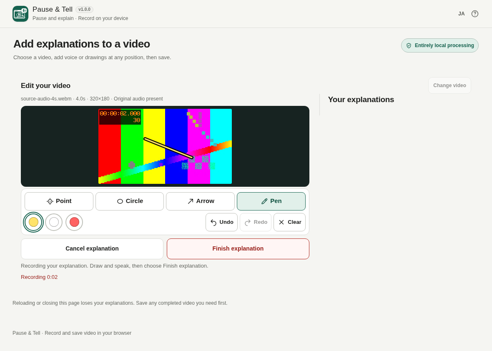

# Pause & Tell

[](https://github.com/ttomohisa/htmlapps-pause-and-tell/actions/workflows/deploy-pages.yml)
[](LICENSE)
[](https://ttomohisa.github.io/htmlapps-pause-and-tell/)

[日本語版 README](README.ja.md)

A privacy-focused, single-HTML app for recording narrated drawings and inserting them into a complete source video, without automatically uploading your media.

## 🚀 Live demo

### [Open Pause & Tell on GitHub Pages](https://ttomohisa.github.io/htmlapps-pause-and-tell/)

GitHub Pages delivers the initial HTML. After it loads, video import, narration recording, drawing and composition are processed locally on your device. Selected videos and recorded audio are not automatically uploaded.

[](https://ttomohisa.github.io/htmlapps-pause-and-tell/)

## Features

- **Explain without a microphone** — Choose “Do not record audio” to draw silently. The elapsed time from starting to finishing is inserted into the video.

- **Explain at the right moment** — Choose a source position and record your voice and drawings over a frozen frame.
- **Keep the original sequence** — Insert explanations while retaining every original video interval and its soundtrack around them.
- **Show what you mean** — Use Point, Circle, Arrow or Pen, three colors, Undo/Redo and Clear.
- **Review each explanation** — Preview, delete or rerecord a clip; cancelling a rerecording retains the original.
- **Save for your audience** — Export standard WebM or experimental short MP4 on compatible devices, with editable filenames and optional device sharing.
- **Private, single-HTML operation** — Embedded runtime, Japanese/English UI and responsive desktop/phone controls.

## Quick start

### Use the web demo

Just [open the demo](https://ttomohisa.github.io/htmlapps-pause-and-tell/). No installation or account is required.

### Use the download file

1. Save the published [readable HTML](https://ttomohisa.github.io/htmlapps-pause-and-tell/index.html) to your device.
2. Open the saved file in a browser with WebCodecs and MediaRecorder support.

If local-file microphone access is unavailable, use the HTTPS app. The hosted file follows the merged main branch.

### Build for offline use (advanced)

1. Download or clone this repository.
2. Run `build-standalone.bat` on Windows with Node.js installed.
3. The build obtains dependencies pinned in `experiments/insertion-poc/package-lock.json`.
4. Copy the generated `dist/index.html` or byte-identical `pause-and-tell.html` wherever you need it.
5. Open that single file later without an internet connection. Microphone and codec availability still depend on your browser.

The smaller `dist/index.self-extract.html` is also generated and additionally requires `DecompressionStream`. Python and a local web server are unnecessary for normal use; building requires Node.js and PowerShell.

## Usage

1. [Open the app](https://ttomohisa.github.io/htmlapps-pause-and-tell/), choose a video and move **Position** to the frame you want to explain.
2. Select **Do not record audio** if you want silence. Choose **Add explanation here**; allow the microphone only for audio explanations. Draw with Pen, Point, Circle or Arrow.
3. Choose **Finish explanation** to insert the elapsed time. Selecting an explanation moves the video to its position and shows its drawings. Use **Redo selected explanation** to recreate it; cancelling keeps the original. The trash icon opens an in-app deletion confirmation.
4. Choose **Create video**, review the result, then **Save video**. Open the saved file separately to check playback. Sharing appears only when supported by the device.

Source seeking chooses insertion positions before recording. During an explanation the source stays frozen. Drawing changes appear at their narration times; Undo/Clear do not retroactively erase earlier output frames. Export re-encodes video, so it is not lossless.

## Publish with GitHub Pages

The repository includes a workflow that builds and verifies the single HTML before publishing it to GitHub Pages.

1. In repository **Settings → Pages → Build and deployment → Source**, select **GitHub Actions**.
2. Changes to `main` automatically run **Deploy standalone app to GitHub Pages**.
3. After success, the [public app](https://ttomohisa.github.io/htmlapps-pause-and-tell/) is updated.

Deployment rebuilds from pinned dependencies and checks readable/self-extracting HTML and network restrictions. PR previews are separate from production.

## Development and build layout

```text
.
├─ experiments/insertion-poc/    # Current editor, package.json and npm lock
├─ assets/favicon.svg           # Canonical app icon
├─ app.config.json              # App identity and build settings
├─ build-standalone.bat          # Windows build entry point
├─ build-standalone.ps1          # Single-HTML builder
├─ scripts/                     # Validation and self-extract builder
├─ dist/index.html              # Readable standalone HTML
└─ dist/index.self-extract.html  # Self-extracting variant
```

Run `./scripts/check-repository.ps1` in PowerShell to build and verify both distributions. Never hand-edit generated HTML.

### Update dependencies

Update `experiments/insertion-poc/package.json` and its npm lock together, review the license/source notices, then rebuild. The build verifies pinned package versions/integrity, embeds the library and full MPL license, and generates `dist/dependency-manifest.json`.

Read [AGENTS.md](AGENTS.md), [APP_SPEC.md](APP_SPEC.md) and [test policy](docs/INSERTION_TEST_POLICY.md). Short regressions are routine; long/native milestones remain opt-in. The historical `insertion-poc` directory name does not select another product.

## Privacy and runtime network protection

Video, audio and drawings are processed inside your browser. There are no automatic uploads, runtime CDN downloads, analytics or remote media processing. Hosted use downloads the initial HTML. Explicit device sharing sends only the generated file to the destination you choose.

Explanations are session-only: closing/reloading or OS process termination can lose them. Save successful output before leaving. A failed or cancelled rerecording retains the previous explanation. This is not persistent project recovery.

The generated HTML includes a Content Security Policy with `connect-src 'none'` and directly embedded runtime code. Apart from explicit device sharing to a destination you choose, the app does not transmit your media. For fully disconnected use, open the saved HTML locally.

## Limitations

Recording and video conversion depend on your browser's microphone, MediaRecorder and WebCodecs support. Available input/output codecs vary by device. Use the HTTPS app if local-file microphone access is unavailable.

- **WebM VP8/Opus is standard.** Native AVC/AAC **MP4 is experimental**, limited to **30 seconds of completed output**. It can be useful when the recipient's video app does not support WebM.
- Attempt ceilings are **5 minutes/250 MiB** per source, **2 minutes** per explanation and **10 minutes** of WebM output. These are not processing-speed, memory or success guarantees; use shorter videos on constrained devices.
- Export re-encodes video and is not lossless. Camera formats such as HEVC/HDR and variable-frame-rate footage may not work correctly on every browser.
- Explanations are session-only. Reloading, closing the page or OS termination can lose them. There is no project-save or automatic-restoration feature; save needed completed videos before leaving.
- Broad Android/iPhone compatibility and maximum-capacity operation are not guaranteed. Unsupported codecs are reported rather than silently replaced.

See [validation results](docs/INSERTION_POC_VALIDATION.md) for tested environments and measured limits. No optional AAC/WASM fallback is bundled.

## Dependencies

| Library | Version | License | Purpose |
| --- | ---: | --- | --- |
| Mediabunny | 1.61.5 | MPL-2.0 | Media import, decoding, audio/video composition and export |
| esbuild (build-time only) | 0.25.12 | MIT | Bundle JavaScript into the single HTML |

The esbuild executable is not embedded in the app. See [THIRD_PARTY_NOTICES.md](THIRD_PARTY_NOTICES.md); full runtime license and exact source-package links are available in Help.

## Contributing

Bug reports and feature proposals are welcome through GitHub Issues. See [CONTRIBUTING.md](CONTRIBUTING.md) for development guidance.

## License

Copyright © 2026 ttomohisa

Application code is licensed under the [MIT License](LICENSE). Bundled libraries retain their separate licenses above.

## Catalog metadata

`app.config.json` describes the version, standalone distribution and network-blocking policy. Metadata does not add runtime network permissions. The normal build creates `dist/index.html`, its byte-identical root `pause-and-tell.html`, and the self-extracting variant. These are distributions of the same editor.
